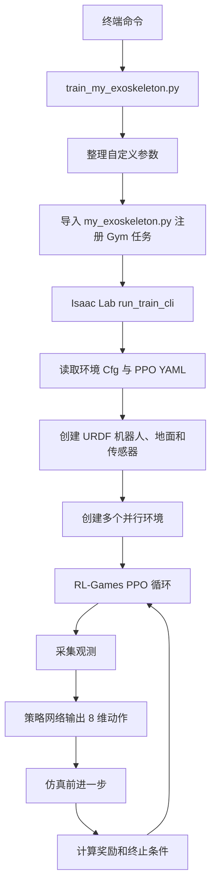
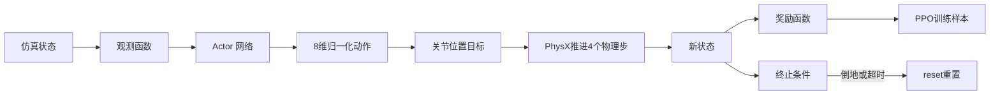
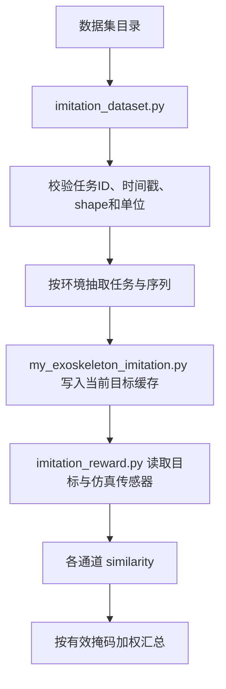
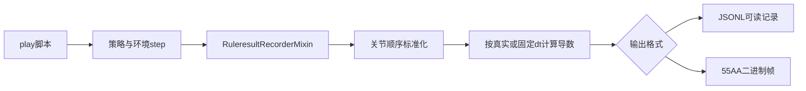
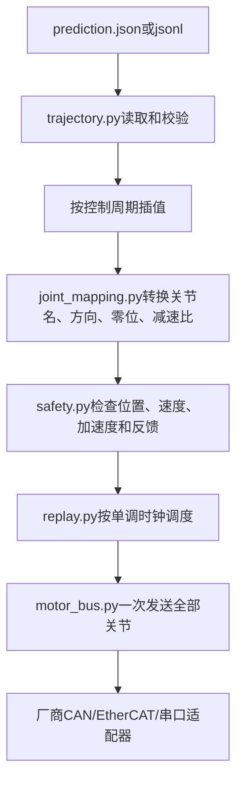

# 外骨骼项目源码导读（零基础版）

这份文档是本项目中文源码注释的总入口。它面向第一次接触 Python、强化学习和
Isaac Lab 的读者，目标不是让你立刻看懂 Isaac Lab 的全部内部实现，而是让你能够：

1. 找到外骨骼项目真正由我们维护的代码；
2. 知道一条训练或回放命令经过了哪些文件；
3. 看懂观测、动作、奖励、回合重置和模型输出之间的关系；
4. 修改一个参数后，知道还需要同步检查哪些地方；
5. 在接入实体电机之前，理解轨迹、映射、安全检查和 `55AA` 通讯帧各自负责什么。

> 阅读原则：先看本文件建立全局认识，再沿着每个源码文件开头的中文“新手导读”进入
> 具体实现。不要从 Isaac Lab 的底层物理引擎开始读，也不要试图一次理解所有函数。

## 1. 本次“整个项目”的范围

当前仓库包含完整的 NVIDIA Isaac Lab，上游代码约有数千个文件。外骨骼项目只是在
这套框架上增加自己的机器人、环境、奖励、数据集、输出协议和启动脚本。因此，本项目
中文注释覆盖的是**外骨骼自定义代码**，不是把第三方框架逐行翻译一遍。

### 1.1 属于外骨骼项目、需要重点阅读的目录

```text
scripts/
├── train_my_exoskeleton.py       # 训练命令入口
├── play_my_exoskeleton.py        # checkpoint 回放和结果导出入口
├── deploy_prediction.py          # prediction.json 的离线安全演练入口
└── deployment/                   # 插值、关节映射、安全检查和电机总线抽象

source/isaaclab_assets/
├── isaaclab_assets/
│   ├── my_exoskeleton.py         # Gym 任务注册表
│   └── sensors/                  # 项目定制的 IMU、接触和事件相机适配器
├── envs/
│   ├── my_exoskeleton_env_cfg.py # 普通行走任务的“总装配清单”
│   └── my_exoskeleton_imitation_env_cfg.py
├── tasks/
│   ├── robot_contract.py         # 关节顺序、控制周期、观测维度等公共契约
│   ├── gait.py                   # 步态编号和课程阶段
│   ├── my_exoskeleton_flat.py    # 普通行走的观测、命令、奖励与课程逻辑
│   ├── my_exoskeleton_imitation.py
│   ├── imitation_dataset.py      # 模仿数据读取、校验和时间对齐
│   ├── imitation_reward.py       # 模仿奖励及多模态观测
│   ├── sensor_reference.py       # 单条参考轨迹缓冲区
│   ├── vision_sensor_cfg.py      # RGB/事件相机配置
│   ├── ruleresult.py             # 角度、速度、角加速度结果导出
│   └── protocol_55aa.py          # 8 电机二进制通讯帧编码
├── configs/                      # PPO、传感器映射和奖励 YAML
└── data/my_robot/urdf/           # 机器人结构的源文件
```

### 1.2 不应该手工添加注释或修改的内容

| 内容 | 原因 |
| --- | --- |
| `.venv/` | Python 和 Isaac Sim 的安装结果，不是项目源码 |
| `logs/`、`outputs/` | 训练和运行产生的数据，下一次运行还会继续生成 |
| `__pycache__/`、`.pytest_cache/` | 缓存文件，可以删除，但不应编辑 |
| `*.pth` | 已训练模型的二进制 checkpoint，人无法直接注释 |
| `*.STL` | 三维网格二进制/文本资产，不是程序逻辑 |
| URDF 导入后产生的 `*.usd`、`*.usda` | 生成物，应修改源 URDF 后重新导入 |
| `uv.lock` | 依赖锁文件，由包管理工具维护 |
| 普通 `source/isaaclab*` 上游模块 | NVIDIA Isaac Lab 框架代码，项目升级时会被上游替换 |

JSON 标准本身不允许注释，所以 `protocol_55aa_config.example.json` 的字段解释放在
`communication_protocol.md` 中。强行向 JSON 插入 `//` 或 `#` 会导致程序无法解析。

## 2. 看代码前只需掌握的 Python 基础

### 2.1 变量和赋值

```python
control_dt_s = 0.02
```

这表示把数值 `0.02` 保存到名字 `control_dt_s` 中。名字里的 `_s` 表示单位是秒。
项目中常见的单位后缀还有：

| 后缀 | 单位 |
| --- | --- |
| `_m` | 米（meter） |
| `_m_s` | 米每秒 |
| `_rad` | 弧度（radian） |
| `_rad_s` | 弧度每秒 |
| `_rad_s2` | 弧度每二次方秒，即角加速度 |
| `_ns` | 纳秒（nanosecond） |

### 2.2 函数

```python
def reward(error: torch.Tensor) -> torch.Tensor:
    return torch.exp(-error.square())
```

`def` 表示定义函数。括号里是输入，`->` 后面是返回值类型，`return` 把结果交还给
调用者。函数不会因为被定义就自动运行；只有其他代码调用 `reward(...)` 时才执行。

### 2.3 类和对象

```python
class ReplayConfig:
    control_period_s: float = 0.02
```

类（class）可以理解为“对象的设计图”。`ReplayConfig()` 会按照设计图创建一个具体
配置对象。Isaac Lab 大量使用 `Cfg` 结尾的类描述场景、观测、动作和奖励。

### 2.4 `import`

```python
from isaaclab_assets.tasks.gait import GaitMode
```

这表示当前文件要使用另一个文件中定义的 `GaitMode`。阅读陌生名字时，先查看它来自
哪条 `import`，通常就能找到定义位置。

### 2.5 `if __name__ == "__main__"`

脚本底部常见：

```python
if __name__ == "__main__":
    raise SystemExit(main())
```

它表示“只有用户直接运行这个文件时才调用 `main()`”。测试代码导入这个文件时，
不会意外开始训练或连接设备。

### 2.6 Tensor 和 shape

Tensor（张量）可以先理解为“能够在 GPU 上批量计算的多维数字表格”。本项目经常
同时仿真很多个外骨骼，所以第一维通常是环境数量：

```text
[num_envs, 8]
```

表示每个环境有 8 个关节值。例如 `num_envs=128` 时，这张表是 128 行、8 列。
注释中的 shape（形状）不会改变数据，它只是帮助读者判断每一维代表什么。

常见 shape：

| shape | 含义 |
| --- | --- |
| `[num_envs]` | 每个环境一个标量，例如总奖励 |
| `[num_envs, 3]` | 每个环境一个 XYZ 三维向量 |
| `[num_envs, 4]` | 每个环境一个四元数 |
| `[num_envs, 8]` | 每个环境的 8 个关节值 |
| `[num_envs, 49]` | 普通任务 actor 的 49 维观测 |

### 2.7 下划线开头的名字

`_helper()` 或 `_cache` 表示模块内部使用的实现细节。它不是绝对禁止外部调用，但修改
它时应先查找所有调用者。没有下划线的类和函数通常是更稳定的公共接口。

## 3. 一条训练命令是怎样运行起来的

以命令为例：

```bash
uv run --extra isaacsim --extra rl-games \
  python scripts/train_my_exoskeleton.py \
  --task Isaac-MyExoskeleton-Imitation-v0 --num_envs=128 --task_id BT02
```

执行顺序如下：



每个文件的职责：

1. `train_my_exoskeleton.py` 只负责启动，不实现奖励公式。
2. `my_exoskeleton.py` 把任务名字连接到环境类、配置类和 PPO YAML。
3. `my_exoskeleton*_env_cfg.py` 决定场景中有哪些对象，以及启用哪些观测、奖励和事件。
4. `my_exoskeleton_flat.py` 和 `my_exoskeleton_imitation.py` 提供运行时计算逻辑。
5. `my_exoskeleton*_ppo.yaml` 决定神经网络和 PPO 如何学习。

### 3.1 为什么启动脚本先处理参数再导入 Isaac Lab

Isaac Sim 有严格的启动顺序，一些模块只能在 Kit 运行时建立后导入。启动脚本中的
`_bootstrap_isaacsim_usd()`、路径注入和延迟 `import` 不是多余代码，不要为了“整理”
而移动到文件顶部。顺序错误可能导致 USD 动态库无法加载或仿真器启动失败。

### 3.2 `--参数` 到底是什么

命令中的 `--num_envs=128`、`--task ...` 都是传给参数解析器的选项。脚本会先消费自己
认识的外骨骼参数，再把通用参数交给 Isaac Lab/Hydra/RL-Games。最后还可能形成：

```text
env.use_imu=False
env.curriculum.gait_commands.params.step_offset=16000
```

这种点号形式叫“配置覆盖”（configuration override），表示运行时临时替换某个嵌套
配置值，不必修改源码文件。

## 4. 一个控制周期内发生了什么

外骨骼每个策略控制周期的核心数据流是：



当前 `CONTROL_DT_S = 0.02`，即策略频率名义上是 `1 / 0.02 = 50 Hz`。物理引擎使用
更小的时间步，策略动作会保持若干物理步。仿真能够比真实时间快或慢；这里的 `0.02`
是模拟时间间隔，不代表普通 Python 文件输出一定每 20 ms 准时落盘。

### 4.1 观测（Observation）

观测是策略在当前时刻能够看到的数字。普通任务把关节位置、关节速度、机体状态、
上一动作、接触、速度命令、步态相位和 gait ID 等拼接成固定长度向量。

Actor 观测是部署时可获得的数据；critic 可以在训练期看到额外的 privileged
observation（特权观测），帮助估计状态价值。部署时不需要运行 critic。

### 4.2 动作（Action）

策略输出 8 个归一化数值，对应 `robot_contract.py` 中固定的 8 关节顺序。环境配置再
使用每关节 scale 把它们转换为关节位置目标。动作尺度不是机械硬限位，也不是最终
发给实体电机的通讯量程。

### 4.3 奖励（Reward）

奖励函数回答“这一小步做得好不好”。每个奖励函数通常返回 shape `[num_envs]`，再由
`RewardTermCfg` 的 `weight` 乘权重。正权重不一定总是奖励：如果函数本身返回负成本，
乘正权重仍是惩罚。判断方向时必须同时看函数公式和配置权重。

### 4.4 终止与重置（Termination / Reset）

倒地检测只负责宣布 episode 结束；reset event 才负责把根姿态、速度和关节状态恢复
到初始值。两者缺一不可。训练中的多个并行环境可以在不同时间独立重置。

### 4.5 课程学习（Curriculum Learning）

课程学习就是先学较简单的任务，再逐步增加难度。`gait.py` 定义阶段编号，环境配置
定义阶段边界，`advance_exoskeleton_curriculum()` 根据全局控制步推进阶段。恢复旧
checkpoint 时，网络和优化器能恢复，但环境课程计数需要用 `step_offset` 补回。

## 5. 两种训练任务的区别

| 项目 | Flat 普通任务 | Imitation 模仿任务 |
| --- | --- | --- |
| Gym ID | `Isaac-MyExoskeleton-Flat-v0` | `Isaac-MyExoskeleton-Imitation-v0` |
| 核心目标 | 根据速度命令学习稳定步态 | 额外模仿数据集中的运动和传感器特征 |
| 环境配置 | `my_exoskeleton_env_cfg.py` | `my_exoskeleton_imitation_env_cfg.py` |
| 运行时环境 | `MyExoskeletonFlatEnv` | `MyExoskeletonImitationEnv` |
| PPO 配置 | `my_exoskeleton_ppo.yaml` | `my_exoskeleton_imitation_ppo.yaml` |
| 数据集 | 可选单轨迹参考 | 多任务、多模态序列 |

模仿任务继承普通任务，而不是复制整套代码。也就是说，普通行走奖励、步态状态机和
安全终止仍然存在，模仿任务在此基础上增加数据集采样、IMU/RGB/Event 目标和模仿奖励。

## 6. 模仿数据从文件到奖励的路径



### 6.1 为什么需要有效掩码（valid mask）

某条数据可能没有 RGB 或事件相机。缺失数据不能当成“完全匹配”，也不能直接产生
NaN。项目用 valid mask 把缺失通道从分子和分母中一起移除，只对真实存在的通道评分。

### 6.2 为什么要统一关节和 IMU 顺序

文件里第 1 列必须和仿真里第 1 个关节含义相同，否则数值看起来合法，动作却会控制到
错误电机。`robot_contract.py` 固定公共关节顺序；IMU 映射配置负责处理数据集命名、
仿真命名和坐标轴差异。不要依赖字典“碰巧按某个顺序读取”。

### 6.3 时间戳和插值

数据采集频率不一定正好等于 50 Hz。加载器先验证时间戳严格递增，再根据目标控制周期
采样或插值。速度、角加速度必须使用真实时间差，不能假设每两个文件记录永远相隔
`0.02 s`。

## 7. 结果输出和未来序列

`ruleresult.py` 位于策略回放之后。它不会改变 actor 的 8 维动作，而是读取环境实际的
关节状态，生成包含角度、速度、角加速度、时间信息和可选预测序列的结构化结果。



重要区别：

- actor 当前输出的是动作，不是 24 维“角度+速度+角加速度”网络头；
- 速度和角加速度可以由相邻状态与时间差计算；
- 只有模型真的训练了 future prediction head，才能说未来多步是模型预测；
- JSONL 适合调试和追溯，二进制帧适合经过审核后的通讯链路。

## 8. 从预测轨迹到实体通讯的路径

实体部署不是“读取 JSON 后直接把三个数字写给电机”。项目当前提供的是安全的 dry-run
骨架，默认不会打开真实硬件：



### 8.1 `trajectory.py`

负责把不同 JSON/JSONL 外形转换为统一的 `Trajectory`。它检查时间戳、关节数量、有限
数值和导数，并支持线性、三次 Hermite 或五次插值。它不负责电机编号。

### 8.2 `joint_mapping.py`

负责从仿真关节坐标转换到硬件坐标，包括关节名称、硬件 ID、正方向、零位和减速比。
转换只能做一次；如果映射层已经转换，协议层就必须使用 identity 标定，不能再乘一次。

### 8.3 `safety.py`

采用 fail-closed（失败即停止）原则。任何 NaN、越界、跳变过快、反馈超时或跟踪误差
都应拒绝继续发送。协议能够表示的范围通常远大于人体和机械真正安全的范围，二者不能
混为一谈。

### 8.4 `replay.py`

使用 monotonic clock（单调时钟）和绝对 deadline 调度，避免系统时间调整或每周期
误差累积。每个周期一次性提交 8 个关节，不能让左腿先更新、右腿稍后更新。无论正常
结束、异常还是用户按 `Ctrl+C`，`finally` 都要执行停止、失能和关闭。

### 8.5 `motor_bus.py`

只定义所有硬件适配器必须实现的接口。当前 `DryRunBus` 用于验证，不连接实体电机。
接入真实设备时，应新增厂商适配器并使用官方 SDK/协议实现 `open`、`enable`、`send`、
`read_state`、`stop`、`disable` 和 `close`。

## 9. `55AA` 通讯协议代码怎样读

完整协议见 `communication_protocol.md`。源码 `protocol_55aa.py` 分三层：

1. 常量层：帧头、长度、帧尾、8 电机固定槽位和物理量程；
2. 原始帧层：把 8 组 `uint16` 编成 53 字节，并检查 XOR；
3. 物理量层：应用标定、软限位和量化，再调用原始帧层。

当前每个电机 6 字节：

```text
目标角度 2 B + 带方向目标速度 2 B + 非负加速度幅值/上限 2 B
```

所有 16 位字段采用大端序（高字节在前）：

```text
q_raw = round((q + 12.57) / 25.14 * 65535)
v_raw = round((v + 20.0) / 40.0 * 65535)
a_raw = round(a * 1000)
```

代码会在量化前检查一次，再把整数按固件公式反解后检查一次。这样可以防止一个原本
刚好在软限位内的浮点值，被量化后推到限位外。全零 payload 代表最小角度和 `-20`
rad/s，绝对不是停止命令。

## 10. 配置文件怎样读

### 10.1 环境 `Cfg` 文件

环境配置像一份装配清单：

| 配置类 | 决定什么 |
| --- | --- |
| `SceneCfg` | 地面、机器人、相机、IMU、接触传感器 |
| `CommandsCfg` | 希望机器人跟踪的目标速度和步态 |
| `ObservationsCfg` | actor/critic 能看到哪些数据 |
| `ActionsCfg` | 8 维网络输出怎样变成关节目标 |
| `RewardsCfg` | 启用哪些奖励函数及其权重 |
| `EventsCfg` | reset 和域随机化时做什么 |
| `TerminationsCfg` | 何时结束一个 episode |
| `CurriculumCfg` | 训练难度何时变化 |

`MyExoskeletonFlatEnvCfg.__post_init__()` 是最终收口位置，负责设置仿真步长、动作重复、
episode 时长和观测维度等跨模块约束。

### 10.2 PPO YAML

常见字段：

| 字段 | 通俗解释 |
| --- | --- |
| `seed` | 随机种子，便于复现实验 |
| `num_actors` | 默认并行环境数量，可被 `--num_envs` 覆盖 |
| `horizon_length` | 每轮从每个环境采集多少控制步 |
| `minibatch_size` | 一大批数据分成多大的小批学习 |
| `learning_rate` | 每次更新网络的步幅 |
| `gamma` | 对未来奖励的重视程度 |
| `e_clip` | PPO 限制策略一次改变过大的范围 |
| `entropy_coef` | 鼓励探索的强度 |
| `seq_length` | LSTM 训练时每段序列长度 |
| `max_epochs` | 最多训练轮数 |

修改网络宽度、观测维度、动作维度或 LSTM 结构后，旧 checkpoint 通常不能继续加载。

### 10.3 URDF

URDF（Unified Robot Description Format）描述连杆和关节：

- `<link>`：一块刚体，包含质量、惯量、视觉网格和碰撞几何；
- `<joint>`：连接两个 link，包含类型、轴、原点和限位；
- `<parent>` / `<child>`：关节两端连接谁；
- `<limit>`：位置、速度和力矩的模型限制；
- `<origin xyz="..." rpy="...">`：相对位置与姿态。

修改关节名会影响环境传感器路径、动作顺序、奖励、数据集映射和通讯映射，不能只改
URDF 一处。网格看起来正确也不代表碰撞体、惯量和关节轴正确，必须单环境可视化验证。

## 11. 模块逐个看：应该先读什么

推荐按下列顺序阅读，而不是按文件大小排序。

### 第 1 组：建立主流程

1. `scripts/train_my_exoskeleton.py`：重点看 `main()`，先忽略参数兼容细节。
2. `isaaclab_assets/my_exoskeleton.py`：看两个 Gym ID 怎样连接配置和环境类。
3. `envs/my_exoskeleton_env_cfg.py`：先只读类名和每个 `Cfg` 的字段。
4. `tasks/robot_contract.py`：记住 8 关节顺序和 50 Hz 控制周期。
5. `tasks/my_exoskeleton_flat.py`：先读 `MyExoskeletonFlatEnv`、观测函数和一个奖励函数。

### 第 2 组：理解训练目标

1. `tasks/gait.py`：五种 gait 和三段 curriculum。
2. `scripts/MY_EXOSKELETON_REWARDS.zh-CN.md`：奖励总表。
3. `tasks/my_exoskeleton_flat.py`：对照总表阅读奖励公式。
4. `configs/my_exoskeleton_ppo.yaml`：策略网络如何学习这些奖励。

### 第 3 组：理解模仿学习

1. `envs/my_exoskeleton_imitation_env_cfg.py`；
2. `tasks/imitation_dataset.py`；
3. `tasks/my_exoskeleton_imitation.py`；
4. `tasks/imitation_reward.py`；
5. `configs/my_exoskeleton_imitation_ppo.yaml`。

### 第 4 组：理解输出和部署

1. `scripts/play_my_exoskeleton.py` 中 ruleresult 参数处理；
2. `tasks/ruleresult.py`；
3. `scripts/deploy_prediction.py`；
4. `scripts/deployment/` 下五个核心模块；
5. `tasks/protocol_55aa.py` 和 `communication_protocol.md`。

## 12. 想修改某项功能时应该去哪里

| 想做的事 | 首先查看 | 通常还要同步检查 |
| --- | --- | --- |
| 改前进目标速度 | `my_exoskeleton_env_cfg.py` 命令配置 | gait 阈值、跟踪奖励、数据集任务速度 |
| 改奖励公式 | `my_exoskeleton_flat.py` | `RewardsCfg` 权重、奖励文档和测试 |
| 新增奖励项 | 奖励函数 + `RewardsCfg` | shape、gait mask、日志名称、单元测试 |
| 改 actor 观测 | 观测拼接函数 | `POLICY_OBS_DIM`、PPO obs group、checkpoint兼容性 |
| 改控制关节 | `robot_contract.py` | URDF、动作Cfg、数据集映射、协议槽位、所有测试 |
| 改倒地判断 | `TerminationsCfg` | reset event、终止惩罚和 episode 指标 |
| 改摩擦随机化 | `EventsCfg` | 课程范围、评估场景、真实测量范围 |
| 改网络层数 | PPO YAML | 旧 checkpoint 是否兼容、显存和 batch 设置 |
| 改输出频率 | ruleresult/回放配置 | 时间戳、插值、导数和硬件控制周期 |
| 接 CAN/EtherCAT | 新建 `MotorBus` 适配器 | SDK、实时线程、看门狗、反馈和急停 |
| 改 55AA 量程 | 固件和 `protocol_55aa.py` 一起评审 | 协议文档、配置 schema、黄金帧测试 |

## 13. 怎样阅读奖励函数

以常见的指数奖励为例：

```python
error = actual - target
reward = torch.exp(-error.square() / sigma**2)
```

可以分三步理解：

1. `actual - target` 得到误差；
2. 平方后正负误差都变成正成本；
3. `exp(-成本)` 把误差映射到 0 到 1，误差越小越接近 1。

检查一个奖励时回答五个问题：

1. 输入使用哪个坐标系，是世界坐标还是机器人自身坐标？
2. 返回 shape 是否为 `[num_envs]`？
3. 数值范围大约是多少？
4. `weight` 的符号和量级是什么？
5. 是否只应在某个 gait 下生效，是否乘了正确 mask？

不要只通过总回报判断奖励是否正确。机器人站着不动也可能通过姿态类奖励获得较高分，
所以还要同时观察前进速度误差、脚接触交替、倒地率和回放画面。

## 14. 怎样阅读测试代码

测试不是额外负担，而是最小的可运行用例。阅读测试时使用 Given / When / Then：

```text
Given：先准备了什么输入和配置？
When：调用了哪个函数？
Then：期望得到什么结果或异常？
```

例如协议测试会给定 8 个已知原始值，编码后检查每一个字节；这比只看编码函数更容易
理解线上的真实格式。修改源码后应扩展最接近的测试，而不是用一次人工运行代替回归。

## 15. 小白修改代码的安全流程

1. 先明确只改一个目标，例如“把固定前进速度从 A 调为 B”。
2. 在本指南第 12 节找到入口文件。
3. 用 `rg` 搜索变量或函数名，确认所有引用。
4. 阅读函数上方 docstring，记录单位、shape 和坐标系。
5. 一次只修改一个逻辑，不顺手重排 import 或大规模重命名。
6. 先运行格式、语法和相关单元测试。
7. 再用少量环境做无界面冒烟训练。
8. 涉及机器人结构时，用单环境可视化检查。
9. 涉及实体输出时，先 dry-run 和硬件在环测试，最后才允许电机使能。

常用的轻量验证命令：

```bash
cd /home/lqf/MyCode/IsaacLab-v3.0.0

# 语法检查：不会启动 Isaac Sim
uv run python -m py_compile 路径/文件.py

# 代码风格检查
uv run ruff check 路径/文件.py

# 运行某个测试文件
PYTEST_DISABLE_PLUGIN_AUTOLOAD=1 uv run pytest -q \
  --confcutdir=source/isaaclab_assets/test \
  source/isaaclab_assets/test/test_protocol_55aa.py
```

注释修改也要验证语法，因为三引号 docstring 没有闭合会让整个文件无法导入。

## 16. 新手最容易混淆的概念

| 概念 | 正确理解 |
| --- | --- |
| physics step | PhysX 积分一次的小时间步 |
| control step | 策略输出一次动作，通常包含多个 physics step |
| PPO iteration / epoch | 收集一批控制步后，网络完成一轮更新 |
| episode | 从 reset 到倒地或超时的一段经历 |
| environment | 并行仿真的一个机器人副本 |
| checkpoint | 网络、优化器等训练状态的保存文件 |
| action | 策略网络输出，不等于最终电机字节 |
| observation | 策略输入的数值向量 |
| reward | 每个控制步的学习评分 |
| command | 希望机器人实现的目标，例如前进速度 |
| feedback | 电机/传感器实际测到的状态 |
| soft limit | 软件允许的更保守范围 |
| wire range | 通讯字段能够编码的最大范围，不代表人体安全范围 |

## 17. 继续深入时使用哪些文档

| 文档 | 用途 |
| --- | --- |
| `source/isaaclab_assets/MY_EXOSKELETON_BEGINNER_GUIDE.zh-CN.md` | 安装、首次训练、恢复与常见故障 |
| `scripts/MY_EXOSKELETON_REWARDS.zh-CN.md` | 当前奖励项总表 |
| `source/isaaclab_assets/MY_EXOSKELETON_PAPER_REPRODUCTION.zh-CN.md` | 论文复现关系 |
| `scripts/ruleresult.md` | 模型结果与未来序列格式 |
| `communication_protocol.md` | 8 电机 `55AA` 字节协议 |
| `deploy_plan.md` | 从离线轨迹到实体机的完整部署方案 |
| `joint_axis_and_knee_constraints.md` | 关节轴与膝关节正负方向 |

这份导读解释“代码怎样连接”，各专项文档解释“某一部分的完整规则”。当源码和文档
不一致时，以经过测试的当前源码为准，并同步修正文档和测试，避免留下两套互相冲突的
说明。
