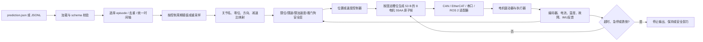

# 外骨骼预测轨迹实体部署方案

本文回答一个核心问题：**把 `prediction.json` 读出来，再把每个关节的角度、角速度、角加速度分别发给电机，够不够？**

结论是：**不够，而且不应直接这样做。** JSON 只是离线数据文件，不是电机驱动器协议，也不是实时控制器。实体部署至少还需要时间基准、插值或重采样、关节与电机的校准映射、控制模式转换、实时通信、状态反馈和故障安全层。没有这些环节，最常见的结果是时间错位、关节顺序错位、方向相反、抖动、跟踪误差累积，甚至在穿戴状态下造成危险动作。

本仓库新增的 `scripts/deployment/` 是一个**不依赖具体硬件的部署骨架**。它默认只运行 dry-run（干跑），不会打开 CAN、EtherCAT、串口或 ROS 2 硬件接口。部署层同时定义了 8 电机 `55AA` 二进制命令帧，但“能生成字节”不等于“可以给实体机上电”。真实设备接入前，必须由现场人员根据驱动器手册实现 `MotorBus` 适配器，并填写经过测量和审查的限位、零位、方向、减速比和通信参数。

## 0. 核心结论：直接读取并发送不够

至少还要处理以下问题：

| 必须补上的环节 | 不处理时会发生什么 |
| --- | --- |
| 时间戳、控制频率和插值 | 目标跳变、延迟累积，驱动器收到过时命令 |
| 控制模式转换 | 把角加速度误当力矩，或把驱动器不接受的字段当成命令 |
| 关节名/ID/零位/方向/减速比映射 | 左右腿反向、关节错位、角度幅值错误 |
| 实时调度和缓冲 | JSON 读盘或 Linux 调度抖动直接传到电机 |
| 位置、速度、加速度、jerk 和电流限幅 | 超出机械或驱动器能力，造成冲击 |
| 编码器和驱动器反馈闭环 | 命令发出但关节未运动、卡死或故障时无人发现 |
| 全关节同步与通信 watchdog | 一条腿更新、另一条腿没更新，或断线后保持旧命令 |
| 硬件急停、跌倒检测和故障状态机 | 软件异常可能继续驱动穿戴设备 |

因此，正确的最小链路是“**文件预解析 → 时间重采样 → 关节校准映射 → 安全层 → 合适的控制器 → 原子整帧通信 → 反馈监控 → watchdog/急停**”，而不是“读文件后逐行 `send()`”。

## 1. 先看当前项目的数据契约

### 1.1 当前项目实际上输出什么

仓库目前没有固定的实体机 `prediction.json` 文件。`ruleresult` 记录器默认输出的是**JSONL（JSON Lines，每行一个 JSON 对象）**，例如 `logs/ruleresult.jsonl`。用户所说的单个 `prediction.json` 也可以使用，但它必须满足同样的数据契约。

当前策略的公共关节顺序固定为右腿四个关节、左腿四个关节，共 8 个：

| 序号 | 关节名 | 单位 |
| ---: | --- | --- |
| 0 | `base_to_Rturn` | rad |
| 1 | `Rturn_to_Rthigh` | rad |
| 2 | `Rthigh_to_Rleg` | rad |
| 3 | `Rleg_to_Rfoot` | rad |
| 4 | `base_to_Lturn` | rad |
| 5 | `Lturn_to_Lthigh` | rad |
| 6 | `Lthigh_to_Lleg` | rad |
| 7 | `Lleg_to_Lfoot` | rad |

每个样本的主要字段是：

```json
{
  "schema": "ruleresult/v1",
  "timestamp_s": 0.02,
  "joint_names": ["base_to_Rturn", "Rturn_to_Rthigh", "Rthigh_to_Rleg", "Rleg_to_Rfoot", "base_to_Lturn", "Lturn_to_Lthigh", "Lthigh_to_Lleg", "Lleg_to_Lfoot"],
  "angle_rad": [0, 0, 0, 0, 0, 0, 0, 0],
  "velocity_rad_s": [0, 0, 0, 0, 0, 0, 0, 0],
  "angular_acceleration_rad_s2": [0, 0, 0, 0, 0, 0, 0, 0]
}
```

角度的单位是 `rad`，角速度是 `rad/s`，角加速度是 `rad/s²`。这里的 `angle_rad` 是处理后的绝对位置目标；训练策略内部的 `raw_action` 不能直接当成电机角度发送。项目中的策略仿真周期是 `0.005 s × 4 = 0.02 s`，因此名义策略频率为 50 Hz。

### 1.2 嵌套预测的时间含义

某些 `ruleresult/v1` 行还包含 `prediction`：

```json
{
  "timestamp_s": 1.00,
  "prediction": {
    "timestamps_s": [0.02, 0.04, 0.06],
    "angle_rad": [[...], [...], [...]],
    "velocity_rad_s": [[...], [...], [...]],
    "angular_acceleration_rad_s2": [[...], [...], [...]],
    "valid_mask": [true, true, true]
  }
}
```

这里的 `prediction.timestamps_s` 是**相对于外层 `timestamp_s` 的未来时间**，不是 Unix 时间戳。绝对轨迹时间应计算为 `外层 timestamp_s + 内层 timestamps_s[i]`。不同 JSONL 行的预测窗口可能重叠；因此部署骨架默认使用每行的顶层样本，只有明确确认窗口可以拼接时才使用 `--use-nested-prediction`。重复运行记录器会以追加方式写文件，部署前必须选择正确的 `episode`，或使用新文件，避免把旧回合混入轨迹。

如果使用单个对象中的顶层序列字段（例如 `angle_rad` 是 `[H, 8]`），其 `timestamps_s` 按绝对轨迹时间解释；只有 `prediction.timestamps_s` 明确是相对外层时间。不要把两种格式混写。

### 1.3 实体机线路输出：8 电机 `55AA` 帧

JSON/JSONL 继续作为 8 关节浮点规划数据，不直接发送给电机。部署层在插值、关节
标定和安全检查完成后，再按 `communication_protocol.md` 编码成固定 53 字节：

```text
55 AA | 32 | 48 B 电机数据 | XOR | 5A
```

- 帧头：`0x55 0xAA`。
- 长度：`0x32`，表示长度字段之后的 50 字节。
- 数据：8 个电机槽位，每槽为目标位置、带方向目标速度、非负加速度幅值/上限三个 `uint16`，共
  `8 * 6 = 48 B`。
- 字节序：所有 `uint16` 使用大端序（big-endian，高字节在前）。
- 校验：对帧头、长度和全部数据，即偏移 0--50，逐字节 XOR；不含校验和帧尾。
- 帧尾：`0x5A`。

协议槽位固定为：左踝、右踝、左膝、右膝、左髋屈伸、右髋屈伸、左髋转向、右髋
转向。该顺序与 JSONL 的公共关节顺序不同，必须按名称重排，不能按原数组下标复制。
完整偏移和量化公式见 `communication_protocol.md`。

**通俗解释：** 接收代码先拼出整数，再按固定量尺还原角度和速度。因此无符号原始值
也可以表示负角度和负速度；不能沿用旧版“速度取绝对值”的做法。加速度字段只能
表示大小，不能携带负方向。协议的最大量程不是机械或人体安全限位。

**技术细节：** 按用户提供的 C 解析式，位置为 `raw / 65535 * 25.14 - 12.57`，
范围 `±12.57 rad`；速度为 `raw / 65535 * 40 - 20`，范围 `±20 rad/s`；加速度
约定为 `raw / 1000`，范围 `0..65.535 rad/s²`。加速度解析尚需与实体固件确认。
速度保留 `direction * gear_ratio * v_joint` 的符号；加速度按轨迹幅值或审核过的
固定上限发送。`0x1234` 在线路上是 `12 34`，不是 `34 12`。软件另行检查更保守的
每关节位置、速度、加速度限值。

零角度/速度量化为 `0x8000`，反解约为 `+0.000191806 rad` 和
`+0.000305180 rad/s`，没有精确零编码。**48B 全零不是停止命令**，会解码为
每电机 `q=-12.57 rad`、`v=-20 rad/s`、`a=0`；停止必须走经验证的安全状态机。

| 协议槽位 | 关节名称 | 机械语义 |
| ---: | --- | --- |
| 1 | `Lleg_to_Lfoot` | 左踝 |
| 2 | `Rleg_to_Rfoot` | 右踝 |
| 3 | `Lthigh_to_Lleg` | 左膝 |
| 4 | `Rthigh_to_Rleg` | 右膝 |
| 5 | `Lturn_to_Lthigh` | 左髋屈伸 |
| 6 | `Rturn_to_Rthigh` | 右髋屈伸 |
| 7 | `base_to_Lturn` | 左髋转向 |
| 8 | `base_to_Rturn` | 右髋转向 |

## 2. 完整部署流程

下面的流程图把“文件中的数字”变成“受安全约束的实时电机帧”：



每一步的通俗解释和技术要求如下。

### 步骤 0：确认设备和控制边界

**通俗解释：** 先弄清楚工控机能和电机驱动器说什么语言，以及驱动器能接受什么类型的命令。不同厂家的“位置命令”字节布局可能完全不同，不能因为都叫 CAN 就直接套用同一段代码。

**技术细节：** 收集驱动器手册和 SDK，确认总线类型、节点地址、端序、缩放因子、单位、CRC、心跳、使能/失能流程、反馈帧、故障复位方式、位置/速度/电流模式以及最高允许周期。仓库的依赖中没有 `python-can`、EtherCAT 主站库、串口库或 `rclpy`；这些都应作为工控机上的可选运行时依赖，不要为了让训练环境通过而伪造协议。

### 步骤 1：预加载并校验文件

**通俗解释：** 不要在控制周期里临时打开文件或解析 JSON。启动前一次性读取到内存，检查每行是否完整、数字是否有限、关节是否齐全，并对时间排序后检查是否能形成严格递增的轨迹。

**技术细节：** `scripts/deployment/trajectory.py` 的 `load_trajectory()` 支持单个 JSON、JSON 数组和 JSONL；会检查（若存在）`ruleresult/v1` schema、8 个规范关节、字段形状、有限浮点数、episode 冲突，并对重叠时间点去重。它按 `angle_rad`、`velocity_rad_s` 和 `angular_acceleration_rad_s2` 的约定读取数值，但不会凭空识别一个数组到底是度还是弧度；单位必须由导出契约和人工预检确认。时间戳默认归一化为从 0 开始。若文件包含多个 episode，必须传 `episode`，否则加载会失败而不是猜测。

### 步骤 2：时间对齐、插值和重采样

**通俗解释：** 文件可能每 20 ms 给一个目标，而驱动器需要每 2 ms 收一次命令。需要在两个文件样本之间算出中间值，不能简单地“等到下一行再跳过去”。

**技术细节：** 设文件采样间隔为 `Δt_json`，工控机发送周期为 `Δt_ctrl`。每个控制时刻 `t_k` 用单调时钟计算，在相邻轨迹点之间求值：

- **线性插值（linear）**：`q(t) = (1-u)q0 + u q1`。最容易验证，不会凭空制造高阶曲线；但速度可能在节点处不连续。
- **三次 Hermite（hermite3）**：用两端的 `q` 和 `v` 同时约束位置、速度，位置和速度连续。输入的速度必须可信，否则会产生过冲。
- **五次多项式（quintic）**：同时用两端的 `q、v、a`，理论上位置、速度、加速度都连续；必须再做速度、加速度和 jerk 限幅，防止高阶曲线冲出机械范围。

控制线程应使用单调时钟和绝对 deadline：下一次 deadline 由 `deadline += period` 得到，而不是每次用“当前时间 + period”，这样偶发的计算延迟不会持续累积漂移。轨迹应预加载到内存，生产系统可准备约 100--500 ms 的环形缓冲作为起始调参范围，但缓冲越大延迟越大，最终数值要按总线和设备实测。

需要特别注意：Python 线程和普通 Linux 调度并不等于硬实时（hard real-time）。`replay.py` 适合离线、SIL、HIL 和接口验证；若实体机要求严格的最坏延迟，应把周期发送和急停路径放进实时线程、实时 ROS 2 控制器或厂商主站，并让本骨架只负责轨迹预处理和安全策略。

如果工控机落后一个周期，不能把历史命令高速追赶发送；应跳到当前时间对应的轨迹点，或直接进入安全停止。角度跨过 `+π/-π` 时要先按关节实际连续性做 unwrap，否则插值可能绕远路。

### 步骤 3：关节映射和零位校准

**通俗解释：** 仿真里的 `Rthigh_to_Rleg` 不一定就是驱动器的 ID 3；左、右腿还可能有镜像方向，编码器零点也可能偏几度。必须把名称和方向逐一对上。

**技术细节：** 对每个关节配置：硬件 ID、`zero_offset_rad`、方向 `+1/-1`、减速比。骨架使用如下约定：

```text
q_motor = zero_offset_rad + direction * gear_ratio * q_sim
v_motor =               direction * gear_ratio * v_sim
a_motor =               direction * gear_ratio * a_sim
```

这是项目约定，不代表任何特定电机的编码器定义；上电前必须用断能、机械约束或低能量测试验证正方向。`joint_names` 的顺序不一致时，加载器会按名字重排，而缺失或重复名字会拒绝运行。`55AA` 编码器还会从公共顺序重排到固定的 8 个协议槽位；标定文件中的槽位和名称必须同时匹配，防止左右腿或髋、膝、踝错接。

### 步骤 4：把轨迹变成合适的控制命令

**通俗解释：** 角度、角速度、角加速度是“想要的运动状态”，不是三种可以无条件分别塞进电机的数字。最终发什么，取决于驱动器的控制模式。

**技术细节：**

1. **位置模式（优先推荐的第一阶段）**：只把 `q_des` 作为位置目标，驱动器内部的位置环负责跟踪。`v_des` 可在驱动器明确支持时作为速度前馈或轨迹限制，`a_des` 通常用于工控机的 slew/jerk 限制，而不是独立的电机命令。
2. **速度模式**：发送 `v_des`，同时需要外环根据位置误差修正，例如 `v_cmd = v_des + Kp(q_des - q_meas)`，并且要限速、处理积分饱和和停止条件。
3. **力矩/电流模式**：角加速度不能直接当力矩。需要动力学模型和参数辨识，例如 `τ = M(q)a + C(q,v)v + g(q) + τ_friction`，再做力矩限幅、功率和温度保护。当前仓库没有经验证的实体动力学模型，因此骨架拒绝直接使用 torque 模式。

第一版实体验证应选经固件确认的控制模式、低速、小幅度、系留和空载；不要把 JSON 中
的三个字段未经驱动器手册确认就发成三个独立通道。本次 `55AA` 固件公式规定速度为
**带方向目标速度**，不能取绝对值，也不再是“最大速度”上限；它可以作为位置+速度
前馈还是速度模式命令，仍由固件控制器决定。加速度是非负幅值/上限，不能表达完整的
带方向加速度目标，更不能直接当力矩。`limit_source=trajectory` 使用轨迹加速度幅值，
`configured` 使用审核过的固定加速度上限；两种模式的速度都来自带符号轨迹，且都要
检查原始轨迹导数的安全上限。不要为通过编码而随意放宽限值，应修改轨迹或按时间缩放降速。

量化安全不能省略：编码器还会把量化整数反解，按接收端实际目标再检查软限位和
速度/加速度上限，失败就拒绝，不自动裁剪（fail-closed）。轨迹应离软边界留出量化
和浮点余量；`q=0` 在软上限 `0` 下，或 `a=2.0006` 在同值上限下，可能因反解微小
越界而失败。速度安全上限 `0` 也不表示停车：零速度无法精确编码，该配置会拒绝
反解非零的命令。Python 的64位浮点与固件32位 `float` 可能存在最低有效位/舍入差异，
驱动器必须对实际解析值独立复查，再一次性锁存8关节。

### 步骤 5：实时发送和通信

**通俗解释：** JSON 是静态文件，电机却需要在规定时间点收到命令。控制线程必须按时唤醒、一次生成所有关节的完整帧，再交给总线。

**技术细节：** 每个周期执行：读取单调时钟 → 采样轨迹 → 映射 → 安全检查 → 生成含
8 个关节、序号和时间戳的内存 `MotorCommand` → 在 `MotorBus.send()` 内按固定槽位
生成 53 字节 `55AA` 帧并一次性发送。内存对象的序号/时间戳不会被写入当前 `55AA`，
线路上仍无序号/时间戳/ACK。发送线程不要进行磁盘 I/O、复杂日志格式化或内存分配。
53 字节不能装入一帧经典 CAN；若用 CAN FD，数据长度码（Data Length Code，DLC）
不能表示53 B，须用64 B DLC（编码15），补11 B约定填充。接收适配层剥掉11 B填充
后，才能把53 B交给固定帧解码器；填充不参加协议XOR，也不改变 `0x32`。经典CAN
则须另行设计带序号、重组和超时的分片协议。真实 EtherCAT 应使用厂商支持的周期任务和分布式时钟；
串口必须处理拆包、粘包和重新同步。若串口 8N1、50 Hz，每秒线路需求至少
`53 × 50 × 10 = 26500 bit/s`，可从至少 115200 baud 做实测，另为反馈和处理预留余量。
所有介质都必须设置通信 watchdog。

### 步骤 6：读取反馈并闭环监控

**通俗解释：** 不能只相信“命令已经发出”。编码器可能卡住、驱动器可能报错、总线可能断线；必须读回实际位置和速度，判断动作是否真的发生。

**技术细节：** 至少采集实际位置、速度、驱动器故障和反馈时间戳；条件允许时再采集电流、温度、电池和 IMU。计算 `e_q = q_meas - q_des`，超过关节专属跟踪误差阈值就进入 HOLD/FAULT。反馈时间戳应使用同一个单调时钟或做明确的时钟同步；反馈超时不能用旧值继续驱动。dry-run 总线会回显最后命令，仅用于验证软件链路，不代表实体闭环已经验证。

### 步骤 7：安全状态机和停机

**通俗解释：** “停止”不能只等于 Python 循环退出。必须定义上电、校准、使能、运行、保持、故障和急停各状态，以及每个状态允许的动作。

**技术细节：** 推荐状态为 `INIT → CALIBRATING → ARMED → RUNNING → HOLD/FAULT`。任一关节故障、通信 watchdog 超时、反馈超时、软件/机械限位、过流、过温、低电量、IMU 检测到跌倒或按下硬件急停时，整组关节停止正常轨迹，进入驱动器定义的安全状态。软件急停不能替代硬件急停；安全扭矩关闭（若设备支持）应由独立安全回路负责。

## 3. 控制频率和插值的具体判断

### 3.1 什么时候不需要插值

只有当以下条件同时成立时，才可以把每个 JSON 样本直接作为一个控制周期的目标：文件时间间隔与发送周期相同、时间戳没有抖动、总线发送和驱动器执行延迟已测量、驱动器能在该周期内接收全部关节帧。即便如此，仍需做映射、安全和反馈，不能省略。

### 3.2 什么时候必须插值

以下任一条件成立就应重采样：JSON 为 50 Hz 而驱动器为更高频率；总线周期与策略周期不同；时间戳不均匀；需要平滑速度；或驱动器只接受自己的固定 PDO/命令周期。线性插值是第一版最容易排错的选择；确认输入 `v/a` 可信后再启用 Hermite 或五次多项式。

### 3.3 角速度和角加速度是否要重新计算

若文件只可靠地提供角度，应使用实际相邻时间间隔计算：

```text
v[k] = (q[k] - q[k-1]) / (t[k] - t[k-1])
a[k] = (v[k] - v[k-1]) / (0.5 * (Δt[k] + Δt[k-1]))
```

不能固定写死 0.02 s 来掩盖工控机抖动。若文件同时提供了速度和加速度，应检查它们与角度的数值一致性，并在发送前限幅；不一致时优先采用经过验证的角度轨迹重新计算，而不是盲信字段。

## 4. 仓库中的代码骨架

### 4.1 文件职责

```text
scripts/deployment/
  __init__.py          公共导出
  trajectory.py        JSON/JSONL 读取、校验、排序、去重、插值
  joint_mapping.py     关节名、硬件 ID、零位、方向、减速比映射
  motor_bus.py         MotorBus 协议、DryRunBus、反馈数据结构
  safety.py            限位、限速、jerk、反馈、watchdog、状态机
  replay.py            单调时钟、绝对 deadline、全关节同步帧
  protocol_55aa_config.example.json
                       55AA 量化/标定模板（仅示例，禁止直接上机）
source/isaaclab_assets/tasks/protocol_55aa.py
                       53 B 帧编解码、流式拆包和标定量化
scripts/deploy_prediction.py
                       dry-run/check-only 命令行入口
```

这些模块只使用 Python 标准库，因此可以在没有 Isaac Sim 的工控机上做预解析和回放测试。实际总线适配器应实现 `MotorBus` 的 `open/enable/send/read_state/stop/disable/close`，并在 `send()` 内完成厂商协议打包。仓库没有替用户虚构 CAN ID、PDO 或串口帧。

### 4.2 最小可运行示例

下面的示例是软件链路的完整框架，默认不会触碰硬件：

```python
from scripts.deployment import (
    DryRunBus,
    JointMapper,
    ReplayConfig,
    SafetyConfig,
    SafetyLimiter,
    load_trajectory,
    replay,
)

trajectory = load_trajectory(
    "prediction.json",       # 也可以是 ruleresult.jsonl
    use_nested_prediction=False,
)

# 没有真实标定文件时只能使用 identity 映射做 dry-run。
mapper = JointMapper.identity(trajectory.joint_names)

# 真实设备必须填入经过测量的 limits；这里不虚构机械限值。
safety = SafetyLimiter(mapper.hardware_ids, SafetyConfig())
bus = DryRunBus(mapper.hardware_ids)

cycles = replay(
    trajectory,
    bus,
    mapper,
    safety,
    ReplayConfig(
        control_period_s=0.002,  # 例：驱动器周期，必须按手册填写
        interpolation="linear",
        mode="position",
        realtime=False,           # dry-run/CI；实体机必须使用 True
    ),
)
print(f"sent {cycles} complete eight-joint frames")
```

如果要看清“按时间步采样并发送”的核心循环，可以把 `replay()` 理解成下面的伪代码。真实程序还必须保留反馈检查、限位和异常停机，不能为了简短而删除这些步骤：

```python
import time
from scripts.deployment import MotorCommand, load_trajectory

trajectory = load_trajectory("prediction.json")
period_s = 0.002
start_ns = time.monotonic_ns()
deadline_ns = start_ns
sequence = 0
previous_target = None

bus.open()
bus.enable()
try:
    while True:
        now_ns = time.monotonic_ns()
        t_s = min((now_ns - start_ns) / 1e9, trajectory.duration_s)

        # 这里完成线性/Hermite/五次插值，并得到 8 个关节的 q/v/a。
        planned = trajectory.sample(t_s, method="linear")
        mapped = mapper.map_sample(planned)
        hardware_target = make_joint_sample(mapped)  # 仅表示硬件单位
        safe_target = safety.apply(hardware_target, previous=previous_target, dt_s=period_s)

        feedback = bus.read_state()
        safety.check_feedback(feedback, previous_target or safe_target, now_ns=now_ns)
        bus.send(MotorCommand(
            sequence=sequence,
            timestamp_ns=now_ns,
            hardware_ids=mapped.hardware_ids,
            mode="position",
            position_rad=safe_target.angle_rad,
            velocity_rad_s=safe_target.velocity_rad_s,
            acceleration_rad_s2=safe_target.acceleration_rad_s2,
        ))
        previous_target = safe_target
        sequence += 1
        if t_s >= trajectory.duration_s:
            break
        deadline_ns += round(period_s * 1e9)
        sleep_until_monotonic(deadline_ns)  # 绝对 deadline，避免漂移
finally:
    bus.stop()
    bus.disable()
    bus.close()
```

伪代码里的 `make_joint_sample()` 和 `sleep_until_monotonic()` 在仓库中分别由 `replay.py` 的内部转换和定时逻辑承担；它的目的只是展示数据流向，不是某种厂商协议的可直接复制实现。

命令行入口：

```bash
# 只校验，不发送任何帧
PYTHONPATH=scripts python scripts/deploy_prediction.py prediction.json --check-only

# 快速 dry-run，不按墙钟等待
PYTHONPATH=scripts python scripts/deploy_prediction.py prediction.json --fast --quiet

# 使用显式标定文件，并按 50 Hz 发送；这仍然是 dry-run
PYTHONPATH=scripts python scripts/deploy_prediction.py prediction.json \
  --mapping hardware_mapping.json --period 0.02 --interpolation linear
```

`--no-dry-run` 当前会明确拒绝启动，这是有意的安全门槛。没有审查过的真实 `MotorBus` 适配器时，不能把这个脚本用于上电设备。

也可以让仿真播放记录器直接生成连续的 53 字节协议帧，供离线检查或交给另一个经过
审查的发送进程。下面命令只写二进制文件，不会打开真实总线：

```bash
python scripts/play_my_exoskeleton.py \
  --task Isaac-MyExoskeleton-Flat-v0 --checkpoint latest --num_envs=1 --headless \
  --ruleresult \
  --ruleresult-format protocol_55aa \
  --ruleresult-protocol-config /absolute/path/to/reviewed_protocol_55aa_config.json \
  --ruleresult-output logs/ruleresult.bin
```

若省略 `--ruleresult-output`，协议模式默认写 `ruleresult.bin`。为避免新旧线路格式混写，
记录器拒绝打开**已有非空二进制文件**，不会修改其中的旧内容；必须使用新路径
（已有空文件允许）。同一次运行中每个有效输出周期追加 53 字节；该
帧没有时间戳，实际发送仍必须由单调时钟调度，而不能按读盘速度连续灌入驱动器。

### 4.3 标定文件模板

通用 dry-run 的关节到硬件 ID 映射仍可使用下面的格式。这里只展示字段，没有任何
真实硬件 ID：

```json
{
  "joints": {
    "base_to_Rturn":   {"hardware_id": "FILL_RTURN",  "zero_offset_rad": 0.0, "direction": 1,  "gear_ratio": 1.0},
    "Rturn_to_Rthigh": {"hardware_id": "FILL_RTHIGH", "zero_offset_rad": 0.0, "direction": 1,  "gear_ratio": 1.0},
    "Rthigh_to_Rleg":  {"hardware_id": "FILL_RLEG",   "zero_offset_rad": 0.0, "direction": 1,  "gear_ratio": 1.0},
    "Rleg_to_Rfoot":   {"hardware_id": "FILL_RFOOT",  "zero_offset_rad": 0.0, "direction": 1,  "gear_ratio": 1.0},
    "base_to_Lturn":   {"hardware_id": "FILL_LTURN",  "zero_offset_rad": 0.0, "direction": 1,  "gear_ratio": 1.0},
    "Lturn_to_Lthigh": {"hardware_id": "FILL_LTHIGH", "zero_offset_rad": 0.0, "direction": 1,  "gear_ratio": 1.0},
    "Lthigh_to_Lleg":  {"hardware_id": "FILL_LLEG",   "zero_offset_rad": 0.0, "direction": 1,  "gear_ratio": 1.0},
    "Lleg_to_Lfoot":   {"hardware_id": "FILL_LFOOT",  "zero_offset_rad": 0.0, "direction": 1,  "gear_ratio": 1.0}
  }
}
```

实际项目还应有独立的安全配置，至少包括每个关节的最小/最大角度、最大速度、最大加速度、最大 jerk、允许跟踪误差，以及驱动器过流/过温阈值。仿真 URDF 限位不能自动视为人体设备的认证安全限位。

`55AA` 编码使用独立模板
`scripts/deployment/protocol_55aa_config.example.json`。它固定 1--8 槽位，并为每个
电机配置 `position_min_rad`、`position_max_rad`（电机侧软件安全限位）、固定
`velocity_full_scale_rad_s=20.0`、`acceleration_full_scale_rad_s2=65.535`、零位、方向、
减速比和命令安全上限。schema 为 `exoskeleton-55aa-config/v2`，`byte_order` 必须为
`big`，位置编码始终固定 `±12.57 rad`，不会随软限位变化。模板带有 `example_only: true`
与醒目的 `_warning`，其中标定和安全上限数字仅为
字段格式示例，**没有经过实体测量或认证，禁止直接发送给通电或穿戴设备**。协议
加载器会主动拒绝 `example_only: true`，所以模板本身故意不能生成输出帧。
`slot` 必须是严格 JSON 整数 `1..8`，`direction` 必须是严格整数 `±1`；不能用布尔值、
浮点 `1.0` 或字符串替代。软范围与规划目标需留量化/浮点余量，不能把速度上限 `0`
当停车命令；配置与接收端独立停车状态机必须分开验证。

推荐保留模板不变，另建受版本管理的现场配置，并记录每个数值的测量日期、设备编号、
测量人和复核人。替换全部实测参数并完成双人复核、断能和 HIL 测试后，才把现场副本
中的 `example_only` 改为 `false`。不得只改标志而沿用示例数字。加载器检查是一道
防误用门槛，不等同于硬件安全认证；现场程序仍应额外拒绝未经批准的配置文件。

旧 `v1` 配置（小端、可变位置比例、非负速度上限）会被明确拒绝。应按 `v2` 模板重新
复核，不得只更改 schema。旧 `.bin` 没有版本字段，帧长和 XOR 无法识别其端序，必须
隔离旧文件，从浮点 JSONL 重新导出到新路径，不播放或混合追加旧线路帧。

### 4.4 总线适配器伪代码

```python
from dataclasses import replace
from isaaclab_assets.tasks.protocol_55aa import Protocol55AAConfig

# 必须指向 example_only=false 且全部参数已经实测、复核的现场配置。
protocol_config = Protocol55AAConfig.from_file(
    "/absolute/path/to/reviewed_protocol_55aa_config.json"
)

class VendorBus:
    def __init__(self, mapper, protocol_config):
        # replay 已执行 JointMapper：frame 是电机侧单位，不能再次做零位/减速比映射。
        self.hardware_ids = mapper.hardware_ids
        id_to_name = dict(zip(mapper.hardware_ids, mapper.source_names))
        self.joint_names = tuple(id_to_name[node] for node in self.hardware_ids)
        by_name = {motor.joint_name: motor for motor in protocol_config.motors}
        for name, calibration in zip(mapper.source_names, mapper.calibrations):
            motor = by_name[name]
            expected = (motor.zero_offset_rad, motor.direction, motor.gear_ratio)
            actual = (calibration.zero_offset_rad, calibration.direction, calibration.gear_ratio)
            if actual != expected:
                raise ValueError(f"conflicting joint calibration: {name}")
        # 保留实测电机侧软限位/安全上限，只把重复映射变为identity。
        self.motor_side_config = Protocol55AAConfig(tuple(
            replace(motor, zero_offset_rad=0.0, direction=1, gear_ratio=1.0)
            for motor in protocol_config.motors
        ))

    def open(self):
        # 初始化厂商 SDK、配置速率、注册接收回调
        ...

    def enable(self):
        # 按手册逐个或同步使能；检查每个驱动器的 ready 状态
        ...

    def send(self, frame):
        if frame.hardware_ids != self.hardware_ids:
            raise ValueError("hardware ID order mismatch")
        if frame.mode not in {"position", "position_velocity_ff"}:
            raise ValueError("unverified motor control mode")
        # 规范关节名 != 硬件ID；用明确定义的关联找名字，再按协议1..8重排。
        payload = self.motor_side_config.encode(
            self.joint_names,
            frame.position_rad,
            frame.velocity_rad_s,
            frame.acceleration_rad_s2,
        )
        assert len(payload) == 53
        vendor_send(payload)

    def read_state(self):
        # 读取同一周期的编码器、速度、电流、温度、故障和时间戳
        ...

    def stop(self):
        # 发送厂商定义的安全停机/保持命令；急停仍由硬件回路负责
        ...

    def disable(self):
        # 按厂商安全状态机失能；不是发送全零控制数据。
        ...

    def close(self):
        # 释放SDK/串口/主站资源。
        ...

# 此前 mapper 必须来自实测 hardware_mapping.json，且与协议标定一致。
# bus = VendorBus(mapper, protocol_config)
```

这段是适配器伪代码，`vendor_send()` 和反馈解析必须由厂商 SDK 实现，当前脚本不会
自动连接硬件。两条合法链路二选一：直接把**关节侧**样本和规范 `joint_names` 交给原
`protocol_config.encode()`，由它标定一次；或像上述 `replay` 链路，先用 `JointMapper`
转换为**电机侧**，再用 identity 标定的量化配置编码。禁止把硬件 ID 当关节名传入，
也禁止对已经标定的电机角度再加零位、乘减速比。内存 `MotorCommand` 的序号和
时间戳不在线路帧中传输，设备端的同步/看门狗必须独立实现。

CAN FD、EtherCAT、串口和 ROS 2 的区别只影响这个适配器及其实时线程，不能绕过上面的轨迹校验和安全层。经典 CAN 单帧无法承载 53 字节，除非另行实现本文尚未定义的可靠分片协议。ROS 2 实体机需要实现 `hardware_interface::SystemInterface` 或使用厂商已有插件，并把控制器从仿真的 `gz_ros2_control/GazeboSimSystem` 替换掉；当前 URDF 中的 Gazebo 插件不能直接驱动实体硬件。
`vendor_send(payload)` 若使用 CAN FD，应发送 `payload + 11 B` 约定填充，并设置64 B
DLC；接收传输层对相应CAN ID检查64 B后移除填充，再调用53 B解码函数。不要把64 B
直接交给 `decode_raw_frame()`，也不要把填充纳入本协议校验。

## 5. 项目需要修改或新增的位置

### 已新增

- `scripts/deployment/trajectory.py`：加载 `prediction.json`/JSONL、校验关节顺序、episode、相对预测时间、`valid_mask` 和插值。
- `scripts/deployment/joint_mapping.py`：硬件 ID、零位、方向和减速比。
- `scripts/deployment/motor_bus.py`：总线抽象和 `DryRunBus`。
- `scripts/deployment/safety.py`：命令限位、反馈超时、跟踪误差、急停状态。
- `scripts/deployment/replay.py`：单调时钟、绝对 deadline、同步整帧、异常停机。
- `source/isaaclab_assets/tasks/protocol_55aa.py`：8 电机固定槽位、53 字节帧编解码、XOR 校验和流式拆包。
- `scripts/deployment/protocol_55aa_config.example.json`：协议量化字段模板，仅供离线示例。
- `scripts/deploy_prediction.py`：check-only 和 dry-run 入口。

### 接入真实设备时需要修改

1. 在 `motor_bus.py` 外部或独立包中实现具体 CAN/EtherCAT/串口/ROS 2 `MotorBus`，不要把厂商协议写进轨迹插值器。
2. 基于 `v2` 示例新建并审核现场 `55AA` 配置；用断能测试确认每个槽位的关节名称、方向、零位、减速比、位置软限位和速度/加速度安全上限。编码量程固定，不应改动。
3. 把驱动器的编码器、电流、温度和故障帧转换成 `MotorState`，提供单调或已同步的反馈时间戳。
4. 若驱动器支持位置前馈，明确其单位和接口后再使用 `position_velocity_ff`；否则只发送位置模式。
5. 若项目要让策略原生输出未来序列，应修改 `source/isaaclab_assets/tasks/ruleresult.py` 的导出回调和 schema，并继续保留时间戳、单位和 `valid_mask`；不需要修改现有 PPO 的 8 维位置动作契约。
6. 若使用 ROS 2，新增真实 `hardware_interface` 插件、控制器 YAML 和 URDF 的实体硬件段；不要复用当前 Gazebo 仿真插件。

现有的 `scripts/play_my_exoskeleton.py` 仍是 Isaac Lab 仿真播放脚本，不是实体机驱动入口。它可以生成轨迹文件，但不会替代上述硬件层。

## 6. 安全检查清单

在任何人穿戴之前，逐项记录测试结果：

- [ ] 机械硬限位和软件软限位都已确认，且软件限位比机械极限更保守。
- [ ] 每个关节的角度、速度、加速度、jerk 和电流/力矩上限已填写。
- [ ] 已验证零位、方向符号、减速比和编码器单位；8 个关节顺序没有错位。
- [ ] 接收端与发送端都按 53 字节、`0x32` 长度、大端 `uint16` 和偏移 0--50 XOR 解析。
- [ ] 已核对固定量程：角度 `±12.57 rad`、带方向速度 `±20 rad/s`、非负加速度 `0..65.535 rad/s²`，固件已确认 `raw/1000`。
- [ ] 实测位置/速度/加速度安全限值比协议量程保守，且映射只做一次。
- [ ] 已验证量化反解超出软范围就拒绝；轨迹留量化/浮点余量，固件独立复查实际解析值。
- [ ] `slot/direction` 使用严格整数；速度上限0不是停车命令，独立停车已测试。
- [ ] CAN FD场景已验证64 B DLC、11 B填充及接收端去填充后53 B校验。
- [ ] 已确认全零数据不是停车命令，量化零点微小误差由安全控制器处理。
- [ ] 已隔离旧 `v1` 配置和小端二进制，新输出使用全新文件路径。
- [ ] 已验证固定槽位依次为左踝、右踝、左膝、右膝、左髋、右髋、左转向、右转向。
- [ ] 工控机和驱动器都有通信 watchdog；超时不会继续发送最后一个旧命令。
- [ ] 硬件急停在断电或安全扭矩关闭路径上，软件急停只是补充。
- [ ] 能检测驱动器 fault、过流、过温、低电量、编码器断线和 IMU 跌倒。
- [ ] 任一关节异常时，整组进入 HOLD/FAULT，而不是让其他腿继续走。
- [ ] 启动先校准和保持，再低能量使能；轨迹结束有明确的停机/保持策略。
- [ ] 已做断能单关节、HIL、空载、系留和低速测试，最后才考虑穿戴测试。

## 7. 常见问题与解决方案

| 现象 | 常见原因 | 解决办法 |
| --- | --- | --- |
| 电机每隔一段时间抖一下 | JSON 50 Hz 直接跳到驱动器高频周期，或位置环增益过高 | 先用线性插值；确认单位、周期和位置环参数；逐步增加速度 |
| 所有关节同时延迟 | 工控机用 `sleep(period)` 累积漂移或在循环中读磁盘 | 预加载文件，用单调时钟和绝对 deadline；把日志移出实时线程 |
| 左右腿动作相反 | `direction` 或关节名称映射错误 | 断能逐关节验证正方向，检查 `joint_names` 和映射文件 |
| 运动幅度大很多或小很多 | 角度单位/减速比/零位错误 | 明确 rad、deg、输出轴/电机轴定义，重新测量 gear ratio |
| 运行一会后停机 | 反馈时间戳过旧、watchdog 或跟踪误差超限 | 检查总线最坏延迟、时钟同步和反馈帧；不要简单提高超时掩盖问题 |
| 文件加载时报 episode 冲突 | 记录器以追加模式写入多个回合 | 传 `--episode` 或使用只包含一个回合的新 JSONL |
| 嵌套 prediction 时间重复 | 每行未来窗口重叠，且相对时间未加外层时间 | 使用顶层样本，或显式启用 nested loader 并检查去重结果 |
| 五次插值冲出限位 | 输入速度/加速度不可靠或高阶曲线过冲 | 先退回线性/Hermite；增加速度、加速度、jerk 限制和过冲测试 |
| 角度突然绕一整圈 | 轨迹跨越 `π` 与 `-π` 没有 unwrap | 按关节连续性展开角度后再插值 |
| 只发角度但腿不动 | 驱动器仍在 disable、模式不对或需要使能握手 | 按厂商状态机完成 enable，读取 ready/fault 反馈，不要盲目重发 |
| `a` 被当作力矩后动作异常 | 角加速度不是力矩 | 位置/速度模式先验证；力矩模式必须有逆动力学、限流和辨识参数 |
| 最后一个点速度不为零 | 文件在非零速度处结束 | 生成带停止段的轨迹，或在控制器中按限加速度安全减速，不能瞬间置零 |
| 接收端总报长度错误 | 把 `0x32` 当成十进制 32，或当成整帧长度 | 长度字节应为十进制 50；完整帧固定为 53 B |
| 数值大小完全错误 | 端序不一致或仍播放旧小端文件 | 当前大端 `0x1234` 在线路上必须是 `12 34`；隔离旧 `.bin` 并按 `v2` 重新导出 |
| 负速度变成正速度 | 沿用旧“最大速度”含义，对 `v` 取了绝对值 | 发送 `direction * gear_ratio * v`，固定按 `raw/65535*40-20` 解析 |
| 清零数据后关节突然反向大幅运动 | 把48B全零误当停止 | 全零代表 `q=-12.57 rad`、`v=-20 rad/s`，应走独立停车/急停状态机 |
| 协议导出报告速度或加速度超限 | 原始轨迹、差分噪声或减速比导致超出安全范围 | 检查时间戳与标定，平滑并时间缩放轨迹；不要仅提高安全上限 |
| 浮点目标在限位内但编码被拒绝 | 量化反解值跨过软边界，或零速度上限无法满足 | 对轨迹预留量化与浮点余量；不放宽已审核限位，停机使用独立状态机 |
| CAN FD收到64 B但协议报帧长错误 | 把11 B总线填充当作协议数据 | 传输适配层去除填充，再向协议解码器交付恰好53 B |
| 已有 `.bin` 输出路径被拒绝 | 防止跨版本或跨回合混写的主动保护 | 归档旧文件并指定新路径，原有文件保持不变 |
| XOR 校验不一致 | 把帧尾或校验自身算入，或漏掉帧头/长度 | 只对完整帧偏移 0--50 逐字节 XOR |

## 8. 分阶段落地计划

### 阶段 A：离线和 SIL（软件在环）

1. 用 `--check-only` 验证单 JSON/JSONL、关节顺序、episode 和时间戳。
2. 用 `--fast --quiet` 跑完整 dry-run，检查每帧都有 8 个关节，序号连续，末尾只发送一次终点。
3. 对线性、Hermite、五次插值分别做位置/速度/加速度曲线和限幅检查。
4. 验证协议输出每帧为 53 B、长度为 `0x32`、槽位顺序正确，并用已知向量交叉检查大端、XOR、负速度与量化端点。
5. 人为注入 NaN、重复关节、时间倒退、坏长度、坏校验、反馈超时和 fault，确认程序拒绝命令或进入 FAULT。

### 阶段 B：HIL 和断能测试

1. 接入厂商 SDK 的模拟器或 HIL，不连接人体；验证 53 字节打包、大端、固定量程、XOR、接收看门狗和独立反馈解析；当前协议没有 ACK，如设备另有 ACK 必须单独验证。
2. 电机断能或机械约束下逐个确认零位、方向、ID、限位和使能状态机。
3. 只发送固定小角度位置命令，验证反馈闭环和 watchdog；再接入一条很短的轨迹。

### 阶段 C：系留低速实体测试

1. 空载、低速、小幅度、硬件急停可触达，先测试单腿再测试双腿。
2. 逐步增加轨迹长度和速度，记录命令时间戳、反馈时间戳、跟踪误差、电流、温度和 fault。
3. 只有在所有关节和安全回路通过审查后，才安排穿戴测试，并保留人工急停和支撑。

## 9. 最终回答

因此，工控机“读取 JSON → 逐关节发送角度/速度/加速度”只能算部署的一个很小的起点，不是完整方案。最少必须补上：

1. JSON 与实体控制周期的时间对齐和插值；
2. 单调时钟、缓冲和绝对 deadline 的实时调度；
3. 位置/速度/力矩模式的正确转换（角加速度不能直接当力矩）；
4. 关节名、硬件 ID、零位、方向、减速比和单位映射；
5. 角度、速度、加速度、jerk、过流和过温等安全限制；
6. 编码器/速度/故障/IMU 反馈闭环和跟踪误差处理；
7. 全关节同步帧、通信 watchdog、急停和故障状态机；
8. 分阶段的 SIL、HIL、断能、系留和低速测试。

只有这些环节都由实际硬件参数和驱动器手册验证后，离线预测轨迹才有资格进入实体外骨骼的受控测试流程。
